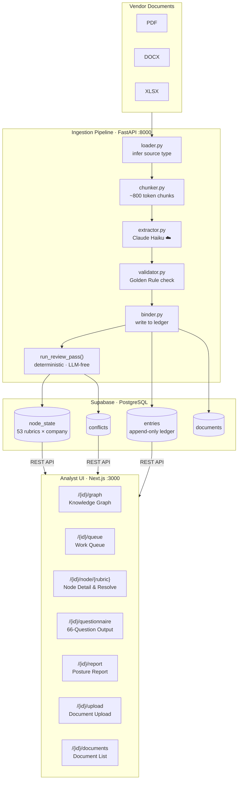
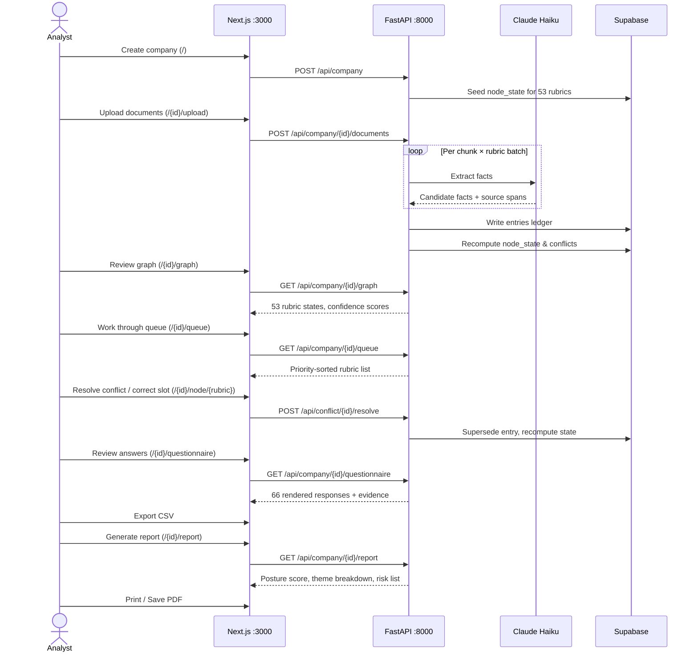

# Agentic Security Analyst

An AI-powered tool that automates vendor security questionnaire assessment. Given a corpus of a vendor's documents (policies, assessments, contracts, infrastructure reports), it extracts evidence through an LLM pipeline, populates a knowledge graph of 53 rubrics across 14 security themes, and surfaces answers, gaps, and conflicts to a human reviewer.

## What it does

Traditional vendor security reviews require an analyst to manually read hundreds of pages of documentation and answer 60+ standardised questions. This tool does the reading automatically:

1. **Ingest** — upload vendor documents (PDF, DOCX, XLSX). The pipeline chunks them, runs keyword-indexed extraction via Claude Haiku, validates every extracted claim against its source text, and writes findings to an append-only ledger.
2. **Review** — a knowledge graph shows the state of all 53 rubrics (verified, conflicted, vague, unknown). The analyst resolves conflicts, fills gaps, and confirms answers.
3. **Report** — the tool renders the completed questionnaire responses and generates a security posture report with theme-by-theme coverage and a ranked risk list.

## Architecture



> **LLM usage:** only `extractor.py` calls an LLM. Everything else — state computation, conflict detection, queue priority, report generation — is deterministic.

## Analyst workflow



## Running locally

### Prerequisites

- Python 3.11+
- Node.js 18+
- A [Supabase](https://supabase.com) project
- An [Anthropic API key](https://console.anthropic.com)

### 1. Environment variables

Create `pipeline/.env`:

```env
ANTHROPIC_API_KEY=sk-ant-api03-...
SUPABASE_URL=https://<ref>.supabase.co
SUPABASE_SERVICE_ROLE_KEY=eyJ...
SUPABASE_DB_URL=postgresql://postgres:<pwd>@db.<ref>.supabase.co:5432/postgres
SUPABASE_ACCESS_TOKEN=sbp_...
```

Create `.env` (root, for Next.js):

```env
SUPABASE_URL=https://<ref>.supabase.co
SUPABASE_PUBLIC_KEY=eyJ...
SUPABASE_SERVICE_ROLE_KEY=eyJ...
ANTHROPIC_API_KEY=sk-ant-api03-...
```

### 2. Database

Push the schema to Supabase:

```powershell
$env:SUPABASE_ACCESS_TOKEN = "sbp_..."
supabase db push --remote
```

### 3. Python backend

```powershell
cd pipeline
python -m venv secvenv
.\secvenv\Scripts\Activate.ps1
pip install -r requirements.txt
uvicorn main:app --reload --port 8000
```

Backend runs at `http://localhost:8000`. Verify with:

```powershell
Invoke-RestMethod http://localhost:8000/health
```

### 4. Next.js frontend

```powershell
npm install
npm run dev
```

Frontend runs at `http://localhost:3000`.

### 5. Regenerate rubrics config (if needed)

```powershell
cd pipeline
python generate_rubrics.py
```

This regenerates `config/rubrics.json` and `config/themes.json` from the hardcoded spec. No API calls are made.

## Smoke tests

```powershell
cd pipeline
python test_db_conn.py          # Supabase direct connection
python test_chat_anthropic.py   # Anthropic API key
```

## Key design decisions

| Decision | Reason |
|---|---|
| Append-only entries ledger | Full audit trail; supersession via `superseded_by` pointer, never deletes |
| Golden Rule: span must be verbatim substring of chunk text | Prevents the LLM from fabricating citations |
| LLM-free review pass | State recomputation is deterministic and cheap — runs after every write |
| Two-pass ingestion (gate rubrics first) | Gate rubrics determine N/A scope for all dependent rubrics before wasting extraction on them |
| Claude Haiku for extraction | Cost — Haiku is ~20× cheaper than Sonnet for high-volume chunk processing |

## Database tables

| Table | Description |
|---|---|
| `companies` | One row per vendor being assessed |
| `entries` | Append-only fact ledger — every extracted or user-submitted claim |
| `node_state` | Current computed state per rubric per company |
| `conflicts` | Open and resolved conflicts between entries |
| `documents` | Metadata for every ingested document |
| `chunks` | Chunk metadata (text lives in memory during ingestion) |
